<div align="center">

# SIGAA UFABC Pro Max - Visual Moderno

**O SIGAA que você usa todo dia, finalmente com a cara do século 21.**

Interface redesenhada, moderna e criada pensando na experiência do usuário.

<a href="https://chromewebstore.google.com/detail/imoodngikpcnjbfmlccfokaomkglkphc">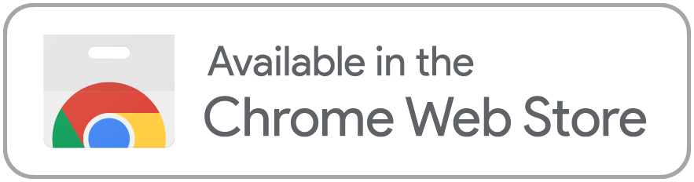</a>
<a href="https://addons.mozilla.org/pt-BR/firefox/addon/sigaa-ufabc-pro-max">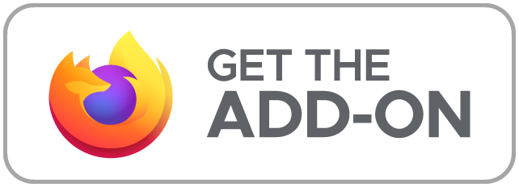</a>
<a href="https://addons.opera.com/pt-br/extensions/details/sigaa-ufabc-pro-max">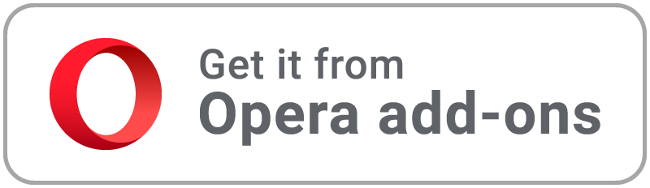</a>

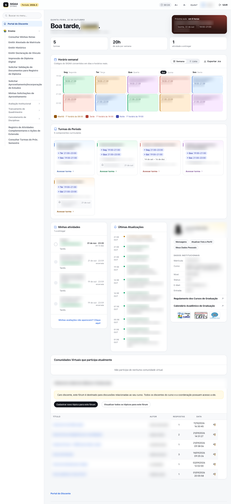

</div>

> [!WARNING]
> **Projeto em desenvolvimento.** Algumas telas do SIGAA ainda não foram redesenhadas e podem aparecer com o visual original. Entretanto, nenhum elemento foi removido, todas as opções originais continuam presentes. Se encontrar algo estranho, [abra uma issue](../../issues).

> [!NOTE]
> **Somente desktop, por enquanto.** A extensão foi pensada para o navegador no computador e funciona no **Chrome**, **Firefox**, **Microsoft Edge** e **Opera**. A versão para celular será desenvolvida em atualizações futuras. Contribuições para o projeto são bem-vindas.

---

## Sumário

- [Motivação](#motivação)
- [Por que usar](#por-que-usar)
- [Conheça as telas](#conheça-as-telas)
- [Privacidade e segurança](#privacidade-e-segurança)
- [Como instalar](#como-instalar)
- [Como voltar ao tema original](#como-voltar-ao-tema-original)
- [Para desenvolvedores](#para-desenvolvedores)
- [Licença](#licença)

---

## Motivação

O SIGAA é a porta de entrada de toda a vida acadêmica na UFABC: matrícula, turmas, notas, frequência, tarefas e fóruns passam por ele. Mesmo assim, a interface parou no tempo, com layout de tabelas dos anos 2000, fonte minúscula, menus suspensos que somem ao mover o mouse e informações importantes espalhadas em telas diferentes.

Na prática, tarefas simples viram uma caça ao tesouro. Descobrir a sala e o horário da próxima aula exige decifrar códigos como `2N45 5N23`. Achar uma opção no menu significa abrir submenu por submenu, e acompanhar prazos de tarefas ou a própria frequência é confuso e cansativo.

Esta extensão nasceu para resolver isso **sem mudar nada no sistema da universidade**: ela só reorganiza e redesenha, no seu navegador, as informações que o SIGAA já mostra, para que você encontre o que precisa em segundos.

## Por que usar

| | |
|---|---|
| 🗓️ **Horário que se lê sozinho** | `3N34` vira **Ter 21:00–23:00**. Veja a semana em calendário ou lista e exporte tudo para o Google Agenda, Outlook ou Apple Calendário com um clique. |
| ⏰ **Próxima aula em destaque** | Assim que entra, você vê qual é a próxima aula, quando começa e em qual sala. |
| 🧭 **Menu que não some** | Todo o menu Ensino / Pesquisa / Extensão / … em uma barra lateral fixa, com **busca**. Digite "notas" e pronto. |
| 📚 **Turmas em cartões** | Horário, sala e última atualização de cada disciplina em um só lugar. Um clique e você está na turma virtual. |
| ✅ **Prazos sob controle** | Tarefas com status (aberta, em breve, encerrada) e contagem regressiva: "encerra em 3 dias". |
| 📊 **Frequência sem conta de cabeça** | Indicadores de porcentagem com a meta de 75% marcada e todas as aulas em um calendário colorido. |
| 🎓 **Notas legíveis** | Cada disciplina em um cartão com o conceito destacado, resumo de aprovações e filtros por situação. |
| 💬 **Fórum que parece conversa** | Tópicos com avatares e respostas organizadas como um chat. |
| 🔒 **Privado e reversível** | Nada sai do seu computador, e você volta ao visual original quando quiser. |

## Conheça as telas

### Um login que dá vontade de entrar

Visual limpo, acesso rápido aos outros sistemas da UFABC e o aviso importante logo abaixo do formulário.

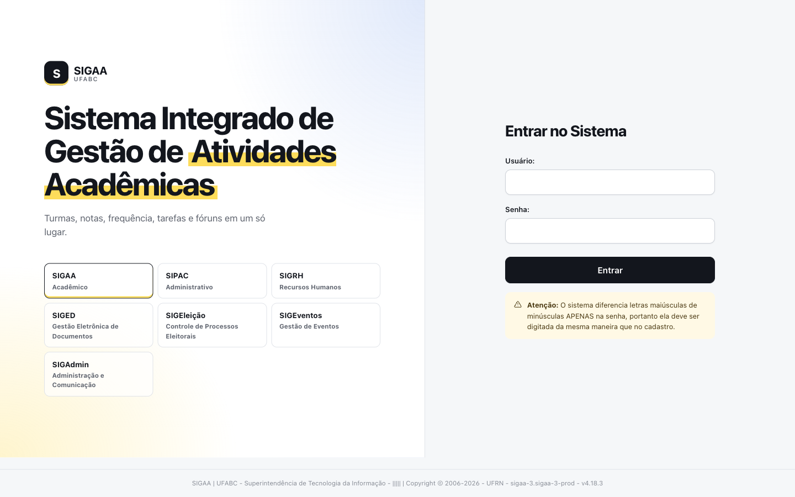

### Direto para onde importa

Na seleção de portal, os acessos que você realmente tem aparecem primeiro, em destaque. O restante fica a um clique.

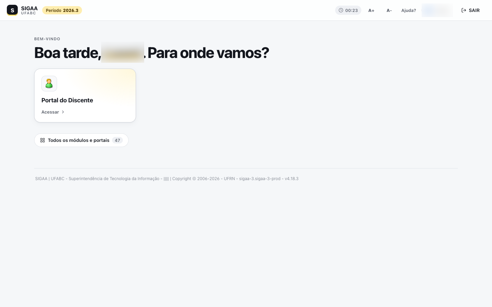

### Seu semestre em uma tela

O Portal do Discente vira um painel: próxima aula, resumo da semana, calendário, turmas, atividades e novidades. Caso não goste, a remoção fica a um clique.


### Horário do jeito que você prefere

Alterne entre a grade semanal e a lista por dia, e exporte para a sua agenda.

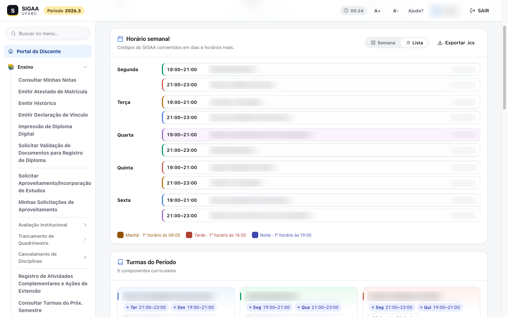

### Turma virtual organizada

A notícia mais recente em destaque e os tópicos das aulas em uma linha do tempo, com o próximo encontro marcado.

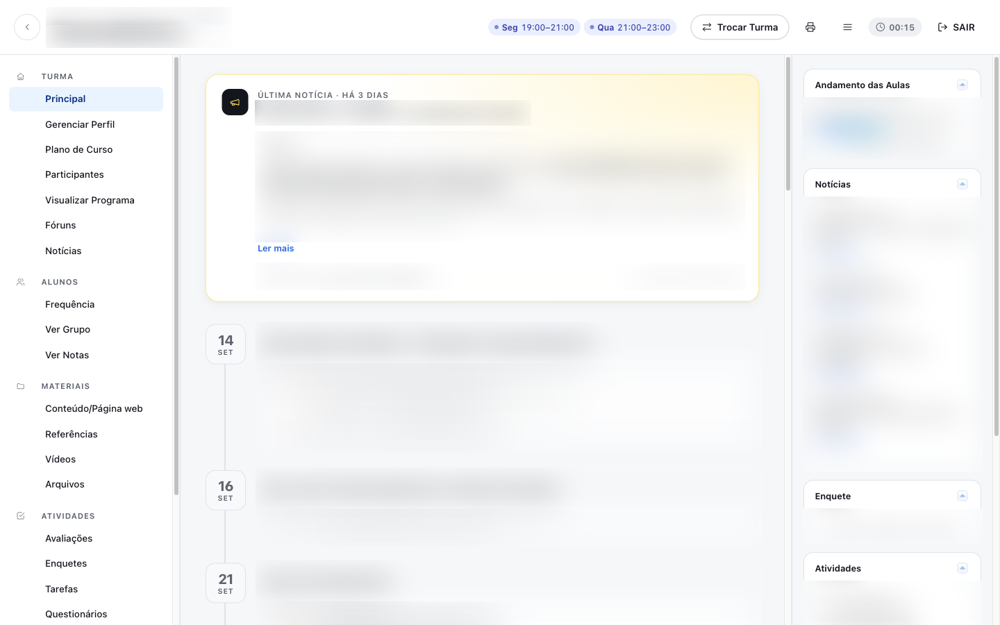

### Quem está na turma

Docentes e colegas em cartões com foto, com busca por nome, curso ou matrícula.

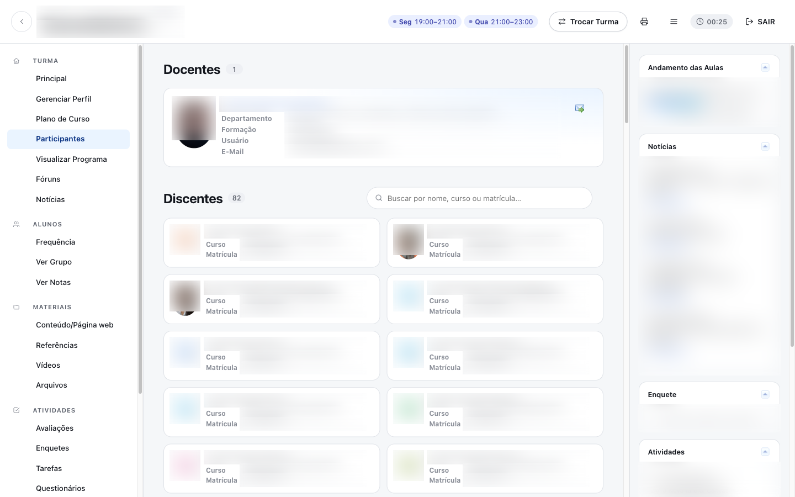

### Frequência num relance

Porcentagem da carga horária e das aulas registradas, com a meta de aprovação, e cada aula marcada no calendário.

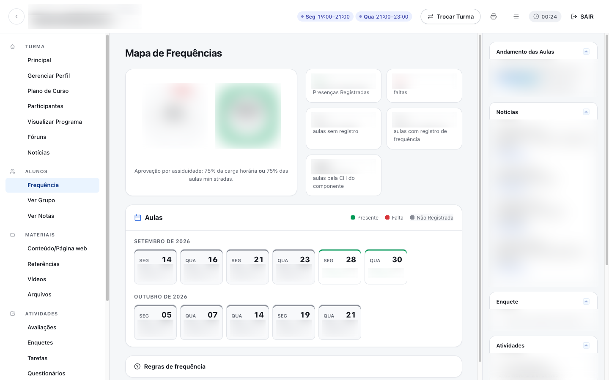

### Tarefas com prazo à vista

Status, contagem regressiva e os botões de envio e visualização sempre à mão.

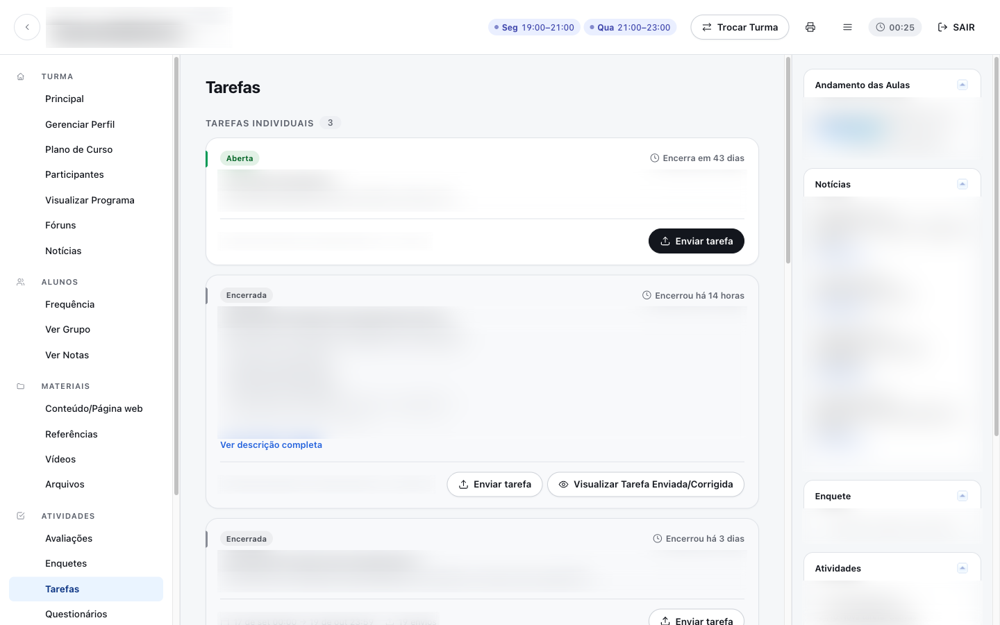

### Notas sem planilha

Disciplinas por período, conceitos coloridos e filtros. Na hora de imprimir, sai o relatório oficial.

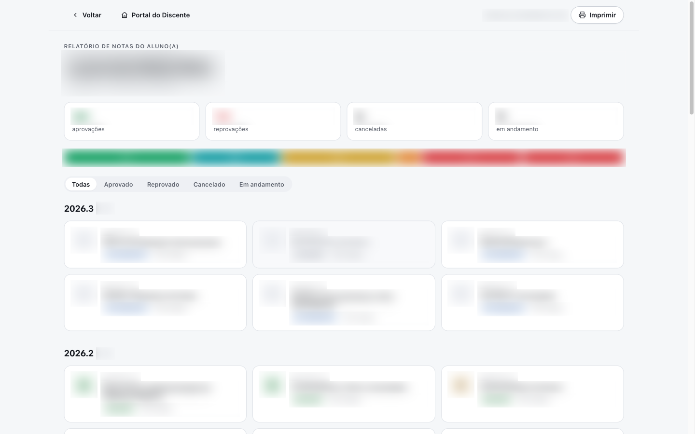

### Fórum mais fácil de acompanhar

Lista de tópicos com respostas visíveis e cada discussão exibida como uma conversa.

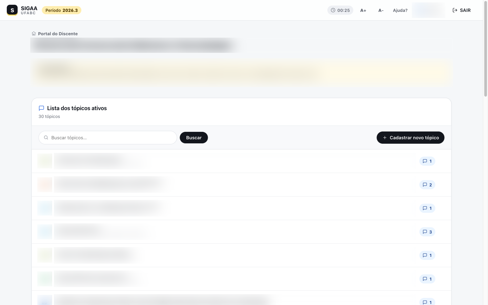

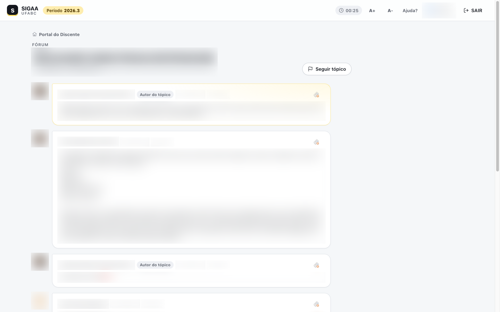

## Privacidade e segurança

- **Não captura, armazena nem envia nenhum dado seu.** A extensão não faz nenhuma requisição de rede própria, não tem servidor e não usa analytics.
- **Atua somente no SIGAA da UFABC.** Ela só roda em páginas de `https://sig.ufabc.edu.br/sigaa/*` e não tem acesso a nenhum outro site.
- **Funciona só no seu navegador.** A extensão usa **CSS** para mudar a aparência dos componentes HTML e um pouco de **JavaScript local** para reorganizar as informações que já estão na tela (por exemplo, transformar uma tabela em cartões ou converter um código de horário). Nada sai do seu computador.
- **O que fica salvo:** apenas as suas preferências (tema ligado/desligado, horários legíveis ligado/desligado) e pequenos detalhes de interface, como quais grupos do menu ficam abertos. São salvos no próprio navegador (`storage.sync` da extensão e `localStorage`).
- **Login e senha:** a extensão não lê nem altera o formulário de login. Ela só muda a aparência dele.

Permissões pedidas pelo navegador:

| Permissão | Para quê |
|---|---|
| `storage` | Guardar as suas preferências. |
| `scripting` | Aplicar ou remover o tema conforme as suas preferências. |
| `https://sig.ufabc.edu.br/sigaa/*` | Restringir acesso da extensão somente às páginas do SIGAA da UFABC. |

O código é aberto e pode ser conferido neste repositório.

## Como instalar

### Pela loja do seu navegador (recomendado)

| Navegador | Loja |
|---|---|
| Google Chrome | <a href="https://chromewebstore.google.com/detail/imoodngikpcnjbfmlccfokaomkglkphc"></a> |
| Mozilla Firefox | <a href="https://addons.mozilla.org/pt-BR/firefox/addon/sigaa-ufabc-pro-max"></a> |
| Opera | <a href="https://addons.opera.com/pt-br/extensions/details/sigaa-ufabc-pro-max"></a> |

1. Clique no selo do seu navegador na tabela acima para abrir a página da extensão.

2. Clique no botão de instalação da loja:
   - **Chrome:** **Usar no Chrome** (ou **Adicionar ao Chrome**).
   - **Firefox:** **Adicionar ao Firefox**.
   - **Opera:** **Adicionar ao Opera**.
   - **Edge**: siga os mesmos passos para o Chrome

3. Na janela de confirmação, clique em **Adicionar extensão** (no Firefox, **Adicionar**).

4. (Opcional) Clique no ícone de extensões ao lado da barra de endereço (🧩 no Chrome, Edge e Firefox; cubo no Opera) e fixe **SIGAA UFABC Pro Max** para deixar o ícone sempre visível.

5. Abra o [SIGAA](https://sig.ufabc.edu.br/sigaa/verTelaLogin.do). O novo visual já estará aplicado.

### Manualmente (a partir deste repositório)

Acesse a página de [**Releases**](../../releases/latest) deste repositório e, na versão mais recente (**Latest**), baixe o arquivo do seu navegador: `sigaa-promax-[versão]-[navegador].zip` (por exemplo, `sigaa-promax-2.2.0-firefox.zip`).

**Chrome, Edge e Opera**

1. Extraia o `.zip` em uma pasta.
2. Acesse a página de extensões: `chrome://extensions` (Chrome), `edge://extensions` (Edge) ou `opera://extensions` (Opera).
3. Ative o **Modo do desenvolvedor** (no Edge fica na barra lateral esquerda; no Chrome e no Opera, no canto superior direito).
4. Clique em **Carregar sem compactação** (ou **Carregar descompactada**) e selecione a pasta da extensão (a que contém o `manifest.json`).
5. Abra o SIGAA. Para atualizar depois, baixe o `.zip` da nova release, substitua os arquivos da pasta e clique em **recarregar** (↻) no cartão da extensão.

**Firefox** (versão 140 ou mais recente)

1. Acesse `about:debugging#/runtime/this-firefox`.
2. Clique em **Carregar extensão temporária…** e selecione o arquivo `.zip` (sem extrair).
3. Abra o SIGAA.

> [!IMPORTANT]
> No Firefox, extensões carregadas por `about:debugging` são removidas ao fechar o navegador. Para uso permanente, instale pelo [Firefox Add-ons](https://addons.mozilla.org/pt-BR/firefox/addon/sigaa-ufabc-pro-max).

## Como voltar ao tema original

Você pode voltar ao visual normal do SIGAA sempre que quiser, sem desinstalar a extensão:

1. Clique no ícone de extensões ao lado da barra de endereço (🧩 no Chrome, Edge e Firefox; cubo no Opera).
2. Clique em **SIGAA UFABC Pro Max** para abrir as opções.
   - Outro caminho: na página de extensões do navegador (`chrome://extensions`, `edge://extensions`, `opera://extensions` ou `about:addons` no Firefox), abra os detalhes da extensão e depois as **Opções**.
3. Desligue a opção **Tema moderno**.
4. Recarregue a página do SIGAA (ou navegue para outra página). O visual original volta.

Para ver de novo os códigos de horário originais (`3N34`), desligue também a opção **Horários legíveis**. Ela funciona de forma independente: dá para usar o visual original do SIGAA com os horários legíveis, ou o tema moderno com os códigos originais.

Para reativar, é só ligar as opções novamente.

> [!NOTE]
> Se a janela de opções mostrar o aviso **"A extensão está sem permissão para acessar o SIGAA"**, o acesso ao site foi desativado nas configurações do navegador. Clique em **Permitir acesso ao SIGAA** para que o novo visual volte a ser aplicado.

## Para desenvolvedores

```
.
├── src/                 # código da extensão, comum a todos os navegadores
│   ├── manifest.json    # Manifest V3 base (é o manifest do Chrome)
│   ├── background.js    # registra os scripts conforme as opções
│   ├── options/         # página de opções (também é o popup do ícone)
│   ├── icons/
│   ├── css/
│   │   ├── base.css     # tokens de design, componentes e elementos nativos do SIGAA
│   │   ├── shell.css    # barra superior, barra lateral, seleção de portal
│   │   ├── portal.css   # Portal do Discente
│   │   ├── turma.css    # Turma Virtual
│   │   ├── paginas.css  # login, notas e fórum
│   │   └── horario.css  # chips de horário (usado também com o tema desligado)
│   └── js/
│       ├── util.js      # utilitários (criação de elementos, datas, ícones)
│       ├── horario.js   # conversão dos códigos de horário, calendário e .ics
│       ├── shell.js     # barra superior e barra lateral
│       ├── portal.js    # painel do Portal do Discente
│       ├── turma.js     # Turma Virtual
│       ├── paginas.js   # login, seleção de portal, notas e fórum
│       └── main.js      # ponto de entrada
├── browsers/            # ajustes do manifest por navegador
│   ├── chrome.json
│   ├── edge.json
│   ├── firefox.json     # background.scripts, ID da extensão e versão mínima do Firefox
│   └── opera.json
├── scripts/
│   └── build.sh         # gera dist/<navegador>/ e os .zip das lojas
├── dist/                # saída do build (não versionada)
└── assets/              # imagens do README
```

- Todos os elementos originais do SIGAA continuam presentes. Eles só foram movidos na interface, e os novos botões acionam os links originais.
- O código é um só para todos os navegadores. O Firefox aceita a API `chrome.*` com promessas no Manifest V3, então não há código específico por navegador.
- Cada arquivo em `browsers/` é um [JSON Merge Patch](https://datatracker.ietf.org/doc/html/rfc7396) aplicado sobre `src/manifest.json`: as chaves são mescladas e `null` remove uma chave. Diferenças entre navegadores vão **somente** nesses arquivos.
- A versão da extensão fica apenas em `src/manifest.json` e vale para todos os navegadores.

### Testando alterações

- **Chrome, Edge e Opera:** carregue a pasta `src/` como extensão sem compactação e clique em recarregar na página de extensões após cada mudança.
- **Firefox:** rode o build e carregue `dist/firefox/manifest.json` em `about:debugging#/runtime/this-firefox` → **Carregar extensão temporária…**. Rode o build de novo e clique em **Recarregar** após cada mudança.

### Gerando os pacotes

Requer `bash`, [`jq`](https://jqlang.org) e `zip`. No macOS 15 ou mais recente todos já vêm instalados; no Linux, instale com `sudo apt install jq zip` (ou o gerenciador da sua distribuição); no Windows, use o WSL ou o Git Bash.

```sh
./scripts/build.sh                  # todos os navegadores
./scripts/build.sh firefox edge     # apenas os navegadores informados
```

Para cada navegador, o script gera a pasta `dist/<navegador>/` (pronta para carregar sem compactação) e o pacote `dist/sigaa-promax-[versão]-[navegador].zip`, por exemplo `sigaa-promax-2.2.0-chrome.zip`. Os arquivos de `src/` são copiados como estão, sem transpilação nem minificação.

---

Projeto independente, sem vínculo oficial com a UFABC ou com a UFRN (desenvolvedora do SIGAA).

## Contribuições

Contribuições são muito bem-vindas! Este é um projeto feito por estudante para estudantes, e cada ajuda deixa o SIGAA melhor para todo mundo.

### Como você pode ajudar

- **Reportar problemas:** encontrou uma tela quebrada ou com o visual estranho? [Abra uma issue](../../issues) contando em qual página aconteceu, o que esperava ver e, se possível, um print **com os seus dados pessoais borrados**.
- **Sugerir melhorias:** tem uma ideia de recurso ou de tela que poderia ser redesenhada? Abra uma issue com a etiqueta `sugestão`.
- **Redesenhar novas telas:** o SIGAA tem muitas páginas que ainda usam o visual original. Escolha uma e mande um pull request.
- **Versão mobile:** ajuda para adaptar a extensão a telas menores é especialmente bem-vinda.
- **Documentação:** correções e melhorias neste README também contam.

### Boas práticas do projeto

- **Sem dependências e sem transpilação:** use apenas HTML, CSS e JavaScript puros, carregados direto pelo navegador. O `scripts/build.sh` só monta o manifest de cada navegador e compacta os arquivos; ele não altera o código.
- **Um código para todos os navegadores:** não crie arquivos de código por navegador. Use apenas APIs disponíveis no Chrome, Firefox, Edge e Opera, e teste ao menos no Chrome e no Firefox. Diferenças de manifest ficam em `browsers/`.
- **Não quebre o SIGAA:** não apague elementos originais. Oculte-os ou mova-os, e faça os novos botões acionarem os links originais, para não quebrar os formulários do sistema.
- **Mantenha os nomes originais:** os rótulos das opções e menus do SIGAA não devem ser renomeados.
- **Respeite a privacidade:** a extensão não pode fazer requisições de rede próprias nem coletar, armazenar ou enviar dados dos usuários. Pull requests que façam isso não serão aceitos.
- **Respeite as opções:** novas funcionalidades devem continuar funcionando com o **Tema moderno** e os **Horários legíveis** ligados ou desligados.
- **Siga o padrão do código:** use os tokens de design (`--sx-*`) do `css/base.css`, o prefixo `sx-` em classes novas e os utilitários de `js/util.js`.
- **Nunca envie dados reais:** prints, exemplos e testes devem ter nomes, matrículas, notas e mensagens borrados ou fictícios.

> Todos os pull requests serão revisados para garantir que estão em conformidade com as práticas acima.

### Código de conduta

Seja respeitoso e acolhedor. Críticas construtivas são ótimas, ataques pessoais não. Lembre-se de que todos aqui estão contribuindo no tempo livre.

Ao contribuir, você concorda que sua contribuição será distribuída sob a mesma [Licença MIT](#licença) do projeto.

## Licença

Distribuído sob a [Licença MIT](LICENSE). Você pode usar, modificar e redistribuir este projeto, inclusive em versões derivadas, desde que mantenha o aviso de copyright e os créditos ao autor original.
